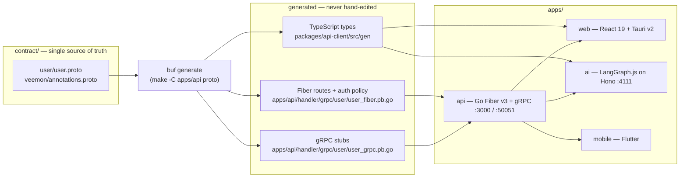

# Veemon

Proto-first polyglot monorepo: a Go Fiber + gRPC backend, a React + Tauri web/desktop
client, a Flutter mobile client, and a LangGraph.js AI service — all generated from one
protobuf contract, with fail-closed auth policies.

[](https://github.com/Solvr-Asia/go-grst-boilerplate/actions/workflows/ci.yml)
[](https://github.com/Solvr-Asia/go-grst-boilerplate/actions/workflows/ci.yml)
[](https://github.com/Solvr-Asia/go-grst-boilerplate/actions/workflows/ci.yml)
[](https://github.com/Solvr-Asia/go-grst-boilerplate/actions/workflows/ci.yml)
[](https://github.com/Solvr-Asia/go-grst-boilerplate/actions/workflows/ci.yml)
[](https://github.com/Solvr-Asia/go-grst-boilerplate/actions/workflows/ci.yml)
[](https://github.com/Solvr-Asia/go-grst-boilerplate/actions/workflows/ci.yml)
[](https://github.com/Solvr-Asia/go-grst-boilerplate/actions/workflows/release.yml)
[](LICENSE)

## Architecture

The proto contract is the single source of truth. `make proto` runs `buf generate`, which
emits the Fiber route table (method, path, auth policy, rate limits), the gRPC stubs, and
the TypeScript message types. Nothing downstream is hand-wired.



## Monorepo Layout

```text
veemon/
├── apps/
│   ├── api/           Go backend — Fiber REST + gRPC, fx DI, cmd/{server,worker,migrate}
│   ├── web/           React 19 + Vite 8 + Tauri v2 desktop shell
│   ├── ai/            LangGraph.js agent + workflow service (Hono, Awilix DI)
│   └── mobile/        Flutter client — Clean Architecture, Cubit, Either<Failure,T>
├── packages/
│   ├── api-client/    @veemon/api-client — protobuf-es types + typed fetch client
│   ├── tsconfig/      @veemon/tsconfig — shared base tsconfig
│   └── go-common/     veemon-common — logging, monitoring, infra/{database,redis,rabbitmq,resilience}
├── contract/
│   ├── user/          user.proto — services, messages, veemon.route annotations
│   └── veemon/        annotations.proto — the custom veemon.route extension
├── docs/assets/       Brand assets (veemon-logo.svg)
├── docker-compose.yml Postgres, Redis, RabbitMQ, Jaeger + one-shot migrate
├── buf.gen.yaml       Codegen config: Go, gRPC, protoc-gen-fiber, protobuf-es
└── package.json       Bun workspaces + root scripts
```

## Quickstart

```
What do you want to run?
├── Just the Go API        → Backend only
├── Everything at once     → Full stack (api + web + ai)
└── Flutter client only    → Mobile only
```

Common prerequisites: Docker (for Postgres/Redis/RabbitMQ), Bun, Go 1.26.9, and `buf`
(`go install github.com/bufbuild/buf/cmd/buf@latest`).

### Backend only

```bash
git clone https://github.com/Solvr-Asia/go-grst-boilerplate.git
cd go-grst-boilerplate

cp apps/api/.env.example apps/api/.env       # no .env.example at the repo root
docker compose up -d postgres redis rabbitmq jaeger

make -C apps/api proto                       # generate routes, stubs, TS types
make -C apps/api migrate-up                  # golang-migrate applies SQL migrations
make -C apps/api run                         # REST on :3000, gRPC on :50051
```

### Full stack

```bash
bun install                                  # all TS workspaces
cp apps/web/.env.example apps/web/.env
cp apps/ai/.env.example  apps/ai/.env        # needs ANTHROPIC_API_KEY to run agents

docker compose up -d postgres redis rabbitmq jaeger
make -C apps/api migrate-up

bun run proto                                # buf codegen (Go + TS)
bun run dev                                  # api :3000 + web :5173 + ai :4111
```

### Mobile only

```bash
make -C apps/mobile get                      # flutter pub get
make -C apps/mobile gen                      # freezed / json / injectable / mocks / l10n
make -C apps/mobile check                    # format-check + analyze + test, what CI runs
make -C apps/mobile run                      # API_BASE_URL defaults to http://10.0.2.2:3000
```

Per-app details: [apps/api/README.md](apps/api/README.md), [apps/web/README.md](apps/web/README.md),
[apps/ai/README.md](apps/ai/README.md), [apps/mobile/README.md](apps/mobile/README.md).

## Tech Stack

| | Go backend (`apps/api`) | Web (`apps/web`) | AI (`apps/ai`) | Mobile (`apps/mobile`) | Contract + infra |
|---|---|---|---|---|---|
| Language | Go 1.26.9 | TypeScript 7 | TypeScript 7 | Dart (Flutter 3.47) | Protobuf 3 |
| Runtime / framework | Fiber v3.6 + gRPC 1.84 | React 19.3 + Vite 8.3 | Hono 4.13 + Bun | Flutter / Material | buf codegen |
| Key libs | GORM 1.31, fx 1.24, Zap 1.28, go-paseto 1.6, OTel 1.47 | TanStack Router + Query, Tauri CLI 2.12 | LangGraph.js, `@langchain/anthropic`, Awilix, Zod | bloc, get_it, fpdart, freezed, dio, go_router | protoc-gen-fiber, protobuf-es 2.2, PostgreSQL 15, Redis 7, RabbitMQ 3, Jaeger 1.53 |

## Feature Highlights

- **Proto-first route generation.** `veemon.route` annotations on each RPC generate the
  Fiber route table, auth policy, response envelope style, and rate limits. No hand-written
  route file exists.
- **Fail-closed authorization.** Every route and RPC needs an explicit policy; a missing
  one is rejected at request time rather than silently exposing an endpoint.
- **PASETO v4 tokens with Redis-backed revocation and login lockout.** Per-account lockout
  after a configurable number of failed attempts; logout revokes the presented token
  immediately.
- **Per-route and global rate limiting.** A global per-IP limiter plus stricter limits on
  unauthenticated auth endpoints, declared inline in the proto.
- **Structured logging and tracing.** Request-ID middleware and Zap JSON logs on every
  request, correlated into OpenTelemetry traces.
- **Metrics and API docs.** Prometheus `/metrics`, plus Scalar-rendered OpenAPI docs at
  `/docs`.
- **SQL migrations via golang-migrate**, run as a one-shot service before the app starts
  in compose.
- **Resilience primitives** (circuit breaker, retry, timeout) in `veemon-common`, ready to
  wrap outbound calls.
- **Clean Architecture Flutter client** with typed `Either<Failure, T>` results, sealed
  freezed states, and DI through `get_it`.
- **LangGraph.js workflows** with Awilix DI and pluggable checkpointing (memory or Postgres).
- **Seven-job CI** across Go, TypeScript, Flutter, and Docker, with race detection and a
  vulnerability scan; tagged releases publish images to ghcr.io.
- **Agent guidance as code.** 27 modular rules under `.claude/rules/`, skills under
  `.claude/skills/`, including SOC 2 and PDPA compliance guidance.

## Add Your First Endpoint

Edit `contract/user/user.proto`. Declare the messages and the RPC, and annotate it with the
`veemon.route` option — the syntax below is copied from `contract/veemon/annotations.proto`:

```protobuf
import "veemon/annotations.proto";

message ListPostsReq {
    string userId = 1 [json_name = "userId"];
    int32 page = 2 [json_name = "page"];
    int32 size = 3 [json_name = "size"];
}

// An RPC with its REST surface, auth policy, and rate limit declared inline.
rpc ListPosts(ListPostsReq) returns (ListPostsRes) {
    option (veemon.route) = {
        method: "GET"
        path: "/api/v1/users/{userId}/posts"
        response: RESPONSE_STYLE_LIST
        auth: { required: true roles: ["admin", "superadmin"] }
        rate_limit: { max: 100 window_seconds: 60 }
    };
}
```

Then regenerate and implement:

```bash
bun run proto          # or: make -C apps/api proto
```

Codegen writes four files you should never edit by hand:
`apps/api/handler/grpc/user/user.pb.go`, `.../user_grpc.pb.go`, `.../user_fiber.pb.go`
(Fiber routes, auth policy, rate limits), and `packages/api-client/src/gen/user/user_pb.ts`.

Implement the method on the service; auth, rate limiting, request binding, and the response
envelope come from the generated route. Full option reference:
[apps/api/README.md](apps/api/README.md).

## Commands

Run from the repo root.

| Script | What it does |
|---|---|
| `bun run proto` | `buf generate` — Go stubs, gRPC stubs, Fiber routes, TS types |
| `bun run build` | Builds api-client, web, ai, then the Go binary |
| `bun run test` | `go test -race ./...` plus Bun tests for the TS workspaces |
| `bun run typecheck` | `tsc --noEmit` across api-client, web, and ai |
| `bun run dev` | api + web + ai concurrently |
| `bun run dev:api` | Go server with hot reload (`air`) |
| `bun run dev:web` | Vite dev server |
| `bun run dev:ai` | LangGraph.js service on Hono, port 4111 |

The backend also has a full `make` interface — migrations, seeds, Docker, and release
targets. See [apps/api/README.md](apps/api/README.md) for the Makefile reference and the
Go-level manual.

## Infrastructure & Observability

`docker compose` brings up the dependency stack; `make -C apps/api compose-up` also starts
the app, running migrations to completion first.

| Service | Image | Host ports |
|---|---|---|
| app | built from `apps/api/Dockerfile` | `3000` REST, `50051` gRPC |
| postgres | `postgres:15-alpine` | `5432` |
| redis | `redis:7-alpine` | `6379` |
| rabbitmq | `rabbitmq:3-management-alpine` | `5672` AMQP, `15672` management |
| jaeger | `jaegertracing/all-in-one:1.53` | `16686` UI, `4317` OTLP gRPC, `4318` OTLP HTTP |

Where to look:

- Scalar API docs: `http://localhost:3000/docs` (OpenAPI JSON at `/docs/openapi.json`)
- Jaeger traces: `http://localhost:16686`
- RabbitMQ management: `http://localhost:15672`
- Prometheus metrics: `http://localhost:3000/metrics`
- Liveness and readiness: `/health` and `/ready`

## Contributing

Branch off `main`, keep commits conventional (`feat:`, `fix:`, `chore:`, `docs:`), and run
`bun run test` and `bun run typecheck` before opening a pull request. CI runs lint, tests
with the race detector, a vulnerability scan, and builds for every app; the reviewer rules
live in [`.claude/rules/`](.claude/rules/).

## License

MIT — see [LICENSE](LICENSE).